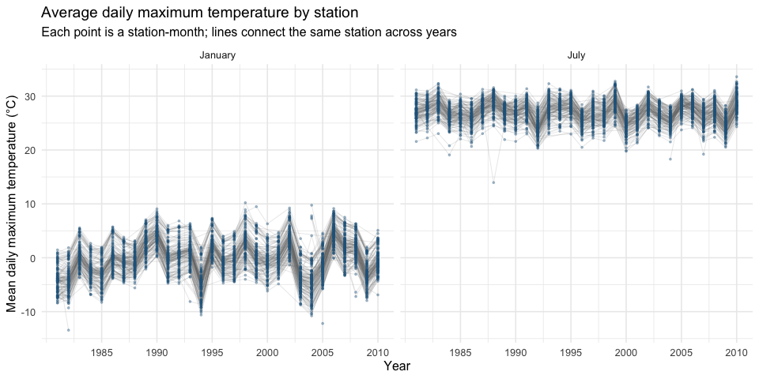
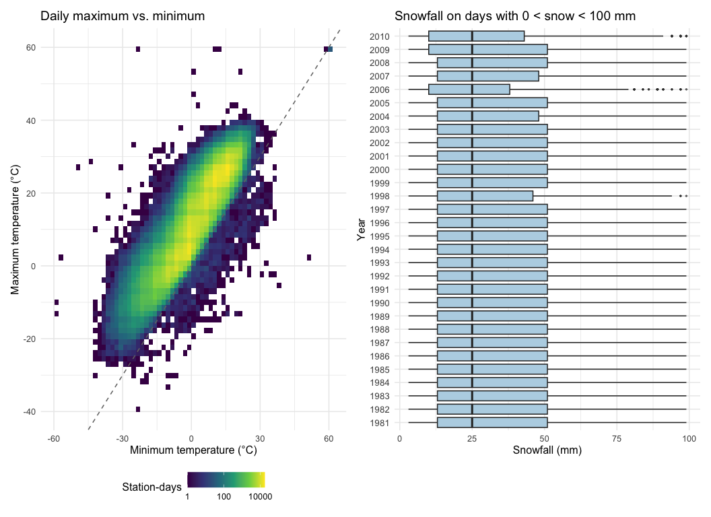

Homework 3
================
Harrison Wei (hw3206)

``` r
library(tidyverse)
library(p8105.datasets)
library(patchwork)

knitr::opts_chunk$set(
  fig.width = 10,
  fig.height = 5,
  out.width = "100%"
)
theme_set(theme_minimal(base_size = 12))
```

## Problem 1: New York weather

I use the NOAA data from the course package rather than keeping a local
copy. Each row is one station on one date; stations do not all report
the same measurements or cover the same years.

``` r
data("ny_noaa")

weather_missing <- ny_noaa |>
  summarize(across(everything(), ~ sum(is.na(.x)))) |>
  pivot_longer(everything(), names_to = "variable", values_to = "missing") |>
  mutate(percent_missing = 100 * missing / nrow(ny_noaa))

weather_missing |>
  knitr::kable(
    digits = 1,
    col.names = c("Variable", "Missing observations", "Missing (%)")
  )
```

| Variable | Missing observations | Missing (%) |
|:---------|---------------------:|------------:|
| id       |                    0 |         0.0 |
| date     |                    0 |         0.0 |
| prcp     |               145838 |         5.6 |
| snow     |               381221 |        14.7 |
| snwd     |               591786 |        22.8 |
| tmax     |              1134358 |        43.7 |
| tmin     |              1134420 |        43.7 |

There are **2,595,176 rows and 7 variables**, covering 747 New York
stations from 1981-01-01 through 2010-12-31. The variables are station
ID, date, precipitation, snowfall, snow depth, and daily maximum and
minimum temperature. Temperature is stored as character text in the
original data. Missingness is substantial: roughly 44% of both
temperature variables are missing, compared with about 6% of
precipitation, 15% of snowfall, and 23% of snow depth. These are missing
measurements, not days with zero rain or snow. Comparisons below
therefore describe the available records rather than a balanced set of
stations.

### Cleaning and snowfall values

The [course data description](https://p8105.com/dataset_noaa.html) gives
temperature in tenths of degrees Celsius and precipitation in tenths of
millimeters. I convert those to degrees Celsius and millimeters.
Snowfall and snow depth are already in millimeters. I also separate the
date into year, month, and day. One snowfall value is negative (-13 mm);
since snowfall cannot be negative, I replace that value with missing
rather than turning it into zero.

``` r
weather <- ny_noaa |>
  mutate(
    year = lubridate::year(date),
    month = lubridate::month(date),
    day = lubridate::day(date),
    tmax = as.numeric(tmax) / 10,
    tmin = as.numeric(tmin) / 10,
    prcp = prcp / 10,
    snow = if_else(snow < 0, NA_integer_, snow)
  )

snow_counts <- weather |>
  filter(!is.na(snow)) |>
  count(snow, sort = TRUE) |>
  slice_head(n = 6)

snow_counts |>
  knitr::kable(col.names = c("Snowfall (mm)", "Station-days"))
```

| Snowfall (mm) | Station-days |
|--------------:|-------------:|
|             0 |      2008508 |
|            25 |        31022 |
|            13 |        23095 |
|            51 |        18274 |
|            76 |        10173 |
|             8 |         9962 |

Zero is by far the most common recorded snowfall: 2,008,508
station-days, or 90.7% of nonmissing snowfall observations. That makes
sense because snowfall is seasonal and many winter days also have no
snow. The next common amounts, 25, 13, 51, and 76 mm, are close to 1,
0.5, 2, and 3 inches. This heaping is consistent with measurements
recorded in inches and then converted and rounded to millimeters, rather
than equally likely snowfall at every millimeter.

### January and July temperatures

I calculate the average daily maximum temperature within each station,
year, and month. A station-month with no temperature observations has no
mean to plot. I keep partly observed months and count their observed
days so that an unusual mean can be checked against its coverage.

``` r
station_month <- weather |>
  filter(month %in% c(1, 7)) |>
  group_by(id, year, month) |>
  summarize(
    observed_days = sum(!is.na(tmax)),
    mean_tmax = mean(tmax, na.rm = TRUE),
    .groups = "drop"
  ) |>
  filter(observed_days > 0) |>
  mutate(month = factor(month, levels = c(1, 7), labels = c("January", "July")))

station_month |>
  ggplot(aes(x = year, y = mean_tmax, group = id)) +
  geom_line(alpha = 0.18, linewidth = 0.3, color = "grey45") +
  geom_point(alpha = 0.35, size = 0.6, color = "#25658A") +
  facet_grid(~ month) +
  scale_x_continuous(breaks = seq(1985, 2010, 5)) +
  labs(
    title = "Average daily maximum temperature by station",
    subtitle = "Each point is a station-month; lines connect the same station across years",
    x = "Year", y = "Mean daily maximum temperature (°C)"
  )
```



The seasonal difference is clear on the common temperature scale: July
station means cluster around the upper 20s, while January means are near
freezing. Many stations rise and fall together across years, suggesting
shared warm or cold seasons. January varies more from year to year than
July. Differences among stations also persist, but these data alone do
not identify how much is due to geography, elevation, or reporting
differences. Changing station coverage makes this a poor basis for a
simple statewide warming claim.

The low July point in 1988 stands out. I check it directly, along with
the coldest January station-month:

``` r
station_month |>
  filter(
    (id == "USC00308962" & year == 1988 & month == "July") |
      (id == "USC00301723" & year == 1982 & month == "January")
  ) |>
  select(id, year, month, observed_days, mean_tmax) |>
  knitr::kable(
    digits = 1,
    col.names = c("Station", "Year", "Month", "Observed days", "Mean maximum (°C)")
  )
```

| Station     | Year | Month   | Observed days | Mean maximum (°C) |
|:------------|-----:|:--------|--------------:|------------------:|
| USC00301723 | 1982 | January |            31 |             -13.4 |
| USC00308962 | 1988 | July    |            31 |              14.0 |

The July 1988 mean is only about 14°C at station USC00308962, even
though all 31 days are observed; it is not explained by just one
recorded day. The January 1982 mean of about -13.4°C at USC00301723 is
also based on 31 days. These deserve investigation, but an outlying
value alone does not establish an error. I retain them here. Some other
station-months are based on very few days, so their averages need extra
caution.

### Temperature relationship and snowfall distributions

A scatterplot would place more than a million points on top of each
other. I use two-dimensional bins instead, with a logarithmic count
scale so that dense regions and sparse observations are both visible.
The second panel includes exactly the requested snowfall range, greater
than 0 and less than 100 mm.

``` r
temperature_plot <- weather |>
  drop_na(tmin, tmax) |>
  ggplot(aes(x = tmin, y = tmax)) +
  geom_bin_2d(bins = 65) +
  geom_abline(slope = 1, intercept = 0, linetype = "dashed", color = "grey45") +
  scale_fill_viridis_c(trans = "log10", name = "Station-days") +
  labs(
    title = "Daily maximum vs. minimum",
    x = "Minimum temperature (°C)", y = "Maximum temperature (°C)"
  ) +
  theme(legend.position = "bottom")

snow_plot <- weather |>
  filter(snow > 0, snow < 100) |>
  ggplot(aes(x = snow, y = factor(year))) +
  geom_boxplot(fill = "#B8D5E5", outlier.alpha = 0.2, outlier.size = 0.5) +
  labs(
    title = "Snowfall on days with 0 < snow < 100 mm",
    x = "Snowfall (mm)", y = "Year"
  ) +
  theme(axis.text.y = element_text(size = 10))

temperature_plot + snow_plot
```



Daily minimum and maximum temperatures have a strong positive
relationship. Most observations lie above the dashed equality line, as
expected. There are also sparse, questionable observations, including
some below the line where the recorded minimum exceeds the maximum. The
source has 1183 such pairs. I show them rather than silently removing
them; the supplied data lack quality flags to resolve them. The most
extreme temperatures should not be treated as reliable weather records
without further checking.

For the selected positive snowfall amounts, the distributions are fairly
similar across years: their medians are around 25 mm, with much of the
data between roughly 13 and 51 mm. The repeated amounts also show up in
these boxplots. This panel says how much snow was recorded **on selected
snowy days**; it does not compare how often snow occurred or the total
annual snowfall, since zero snowfall and values of 100 mm or more are
excluded.

## Problem 2: NHANES activity

## Problem 3: Citi Bike
